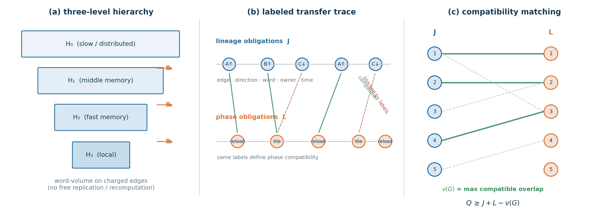

上一篇[《矩阵乘法 I/O 复杂度：研究探索笔记》](../matrix-multiplication-io-complexity-research-notes/)记录了我从经典下界走到多层通信、有限容量模型，以及中间反复修正的过程。这里整理那份笔记后来分出的两条论文线：四词快存储下的 $2\times2\times k$ 精确界，以及按执行轨迹修正多层 I/O 下界重叠的框架。前者在一个受限模型里得到 tight 结果，后者回答的是怎样安全地组合不同通信义务；它们有关联，但不是同一个定理，也不能把前者当成一般 GEMM 的结论。

两份文件目前都是**论文草稿，不是已发表论文**：[四词快存储的精确界（PDF）](../../research/matrix-io/m4_tight_io.pdf)，以及[多层 I/O 重叠修正（PDF）](../../research/matrix-io/spaa_overlap_correction.pdf)。下面只挑正文里最关键的部分讲，不重复上一篇很长的探索日志。

## 1. 四词快存储：一个能够算到底的小问题

先把问题缩到 $A\in\mathbb{R}^{2\times k}$、$B\in\mathbb{R}^{k\times2}$、$C=AB$。只有一个计算 owner，快存储只能放四个 word；每个乘法只执行一次，不允许免费复制或重算，$C$ 的部分和被逐出后再读回来也要计费。在这个明确的 word-traffic 模型里，稿件得到

$$
Q^*(2\times2\times k,M=4)=6k+2,\qquad k\ge1.
$$

这里的重点不是把大规模 GEMM 的渐近指数改掉，而是容量很小时，$A/B$ 的复用和 $C$ 部分和的驻留会互相争空间。单独数“输入又读了几次”或者“输出写了几次”都不够，需要把它们放在同一条执行轨迹里。

### 精确计数

每个 $r$ 对应四个标量乘法，整个计算有 $8k$ 次 $A/B$ operand 请求。设 $H$ 是这些请求中第二次使用时的 cache hit 数，$R_C$ 是一个尚未算完的 $C$ 部分和被逐出、之后又重新载入的次数；四个最终输出各写回一次，于是

$$
Q=8k+4-H+2R_C.
$$

这个式子本身只是记账。真正要证明的是：不能无限增加 $A/B$ 的命中，却不为 $C$ 的反复进出付费。论文把这个约束写成

$$
H-2R_C\le 2k+2.
$$

代回上式就得到 $Q\ge6k+2$；另一边有一个周期性的计算顺序达到 $6k+2$，因此上下界碰在一起。

### 为什么要用有限状态证书

对固定的 $r$，四个可能的 $A/B$ 复用边构成一个四环。如果有 3 次 hit，选中的边是一条覆盖四点的路径；如果有 4 次 hit，则是完整的环。证明只保留这些高复用的部分，把未完成的分量、已经用过的 $C$ label 和仍驻留的 $C$ label 放进状态里，检查“额外复用减去 $C$ restart”的最大值。

草稿里的 max-plus 状态系统在第 16 层和第 20 层得到相同的状态—取值映射，形成四步固定点；固定点有 278 个状态，最大 potential 为 2。这一步是任意 $k$ 的证明证书，而不只是把前几个 $k$ 跑出来看规律。独立实现也重建了同一固定点；随机小实例的投影检查只是编码一致性测试，不代替投影引理。

代码里，上界调度先把 $i=0$ 的 $r$ 顺序循环移位，再按通常顺序处理 $i=1$。下面摘自 `work/generate_2x2k_m4_schedule.py`；返回值是四类 product 的执行次序，不是缓存状态本身：

```python
def schedule(k: int):
    out=[]
    for i, rs in ((0, list(range(1,k))+[0] if k>1 else [0]),
                  (1, list(range(k)))):
        for r in rs:
            for j in (0,1):
                out.append(i*2*k+r*2+j)
    assert len(out)==4*k and len(set(out))==4*k
    return tuple(out)
```

`work/check_2x2k_m4_schedule.py` 用固定顺序的精确 DP 检查了从 $k=1$ 到 $k=10$，得到 `total == 6*k+2`，并检查没有 $C$ 的中途写回或重载。这是对构造的有限规模核对；对任意 $k$ 的结论仍要看论文中的周期调度论证。

下界证书的核心更新则是“同一状态只保留最大 potential”。以下是独立实现 `work/check_high_demand_fixed_point_independent.py` 中的层推进和固定点检查：

```python
def make_layers(count):
    layers = [{((), 0, 0): 0}]
    for _ in range(count):
        nxt = {}
        for state, value in layers[-1].items():
            for ns, restart, gained in successors(state):
                candidate = value - restart + gained
                if candidate > nxt.get(ns, -10**9):
                    nxt[ns] = candidate
        layers.append(nxt)
    return layers

layers = make_layers(20)
maxima = [max(x.values(), default=-10**9) for x in layers]
assert max(maxima) == 2, maxima
assert layers[16] == layers[20]
```

这段程序实际输出 `states_at_fixed_point=278`。其中 `gained` 记录完成高复用分量获得的额外 hit，`restart` 记录 $C$ 重载的代价；状态转移的容量检查和投影正确性才是证书可信的关键，不能只看最后两个 `assert`。

这个结果只覆盖**单 owner、$M=4$、每个 product 恰好算一次、上述 $C$ movement 计费规则**。它不自动推广到多 owner、重计算、免费 multicast、LRU 专属策略，或任意多层内存。

## 2. 多层 I/O：两个下界为什么不能直接相加

另一份草稿问的是更大的问题。矩阵乘法里，一部分数据移动来自 ownership、复制和归约；另一部分来自快存储有限，数据被逐出后不得不重新载入。两类论证各自都能给下界，但**同一次物理传输可能同时满足两边的要求**，所以不能直接把两个数相加。

这份稿件把一次 transfer 需要经过的层级边、方向、word、接收者和时间区间记成 label，再看两个通信义务能否由同一个 transfer 支付。能共享的配对形成一个二分图 $G$：令 $J$ 是 lineage 义务数，$L$ 是 phase 义务数，$\nu(G)$ 是最多能合法配对多少次，那么

$$
Q\ge J+L-\nu(G).
$$



如果所有配对都兼容，这个式子退回常见的 $\max(J,L)$；只有 edge、receiver、word 或时间限制真的阻止共享时，才可能得到更强的界。稿件里有一个最小的 certificate-level 例子：$J=L=2$，但只有一对能共享，于是得到 $Q\ge3$，而单纯取 max 只得到 2。这个例子说明匹配修正怎样工作，**不等于证明每个抽象 label 集都来自真实 GEMM 轨迹**。

`work/run_overlap_certificate_sweep.py` 把每个义务编码为 `(id, edge, direction, word, sender, receiver, start, end)`。能否共用一次传输，先比较除 id 外的物理标签，再检查两个时间区间是否相交：

```python
def compatible(l, p):
    return l[1:6] == p[1:6] and max(l[6], p[6]) < min(l[7], p[7])
```

匹配数由 `work/check_overlap_correction_matching.py` 中的小规模 bitmask DP 求出；同一个 phase 义务最多被配对一次：

```python
from functools import lru_cache

def max_matching(left, right, edges):
    index = {x: i for i, x in enumerate(right)}

    @lru_cache(None)
    def dp(i, mask):
        if i == len(left):
            return 0
        best = dp(i + 1, mask)
        for p in right:
            if (left[i], p) in edges:
                bit = 1 << index[p]
                if not (mask & bit):
                    best = max(best, 1 + dp(i + 1, mask | bit))
        return best

    return dp(0, 0)
```

检查器用 `J=L=2`、仅有一条兼容边的例子验证 `J+L-nu == 3`，再用完全兼容的例子验证它退回 `max(J,L)`。这些脚本检查的是**标签、配对与计数逻辑**；实际多层 GEMM 还要另外证明标签从合法轨迹中抽取，并且所声称的紧界有可执行调度。

对任意合法的多层执行，草稿首先保留一个安全的 envelope：每条边要支付自己的 lineage incidence，总流量也要满足 phase 要求。更强的加法式只在静态嵌套 owner、edge-local phase、事件不重叠等受限条件下，连同能实际嵌入的 schedule 一起成立。这个区分很重要：一个匹配给出“最多能重叠多少”，但从匹配到可执行的调度还要检查容量、路由和部分和的依赖顺序。

## 3. 现在把它们放在什么位置

两份草稿都是上一篇研究笔记的后续，但证据的形状不同。$M=4$ 的结果把一个小而精确的问题闭合了；多层稿件则给出组合通信下界的方法，并把什么时候只能取 max、什么时候可以做重叠修正写清楚。前者是一个具体的 tight theorem，后者是一个更广的框架和受限条件下的 tightness theorem；目前还不能把它们拼成任意多层 GEMM 的统一紧下界。

后续若要继续推进，我会分别追两件事：有限容量模型能否跨过这个 $2\times2\times k$ 特例，以及真实多层执行里哪些 label 冲突能稳定地产生严格修正。原始定义、完整证明和实验口径都以两份 PDF 草稿为准。
